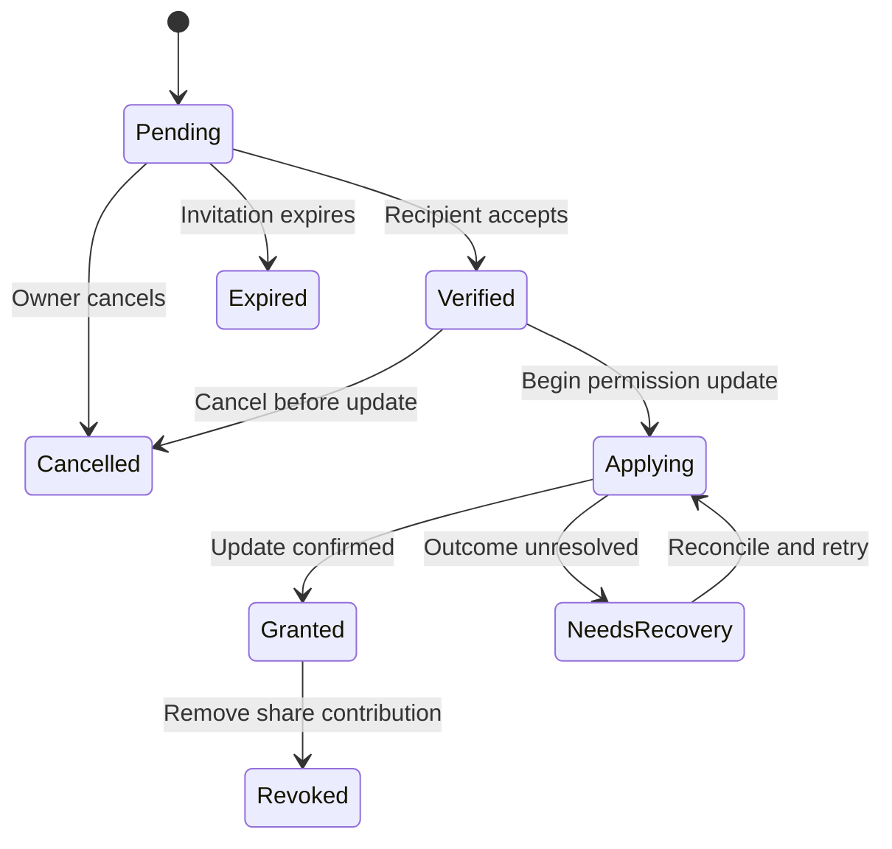

# Solid sharing through user-selected invitation providers

Status: Initial design, version 0.1  
Date: 11 November 2026  
Context: Solid Workbench and applications using its capabilities

## 1. Purpose

Allow someone to share a resource on their own Solid pod with a person whose email address or phone number they know, even when that person's WebID is unknown or does not yet exist.

The owner authorizes the share once. The recipient then accepts it, authenticates with an existing Solid identity or creates one, and receives access without further action by the owner. A trusted server-side invitation/sharing provider completes the workflow while the owner's browser is closed.

Applications invoke a reusable Solid Workbench sharing capability. They do not each implement invitation delivery, identity onboarding, verification or access-control editing.

Users choose their sharing providers and authorize them once for a defined part of their pod. This design uses existing Solid protocols and authorization mechanisms. It requires no extension to the pod server.

## 2. Agreed decisions and boundaries

1. **One confirmation per share.** Provider setup is a separate, occasional operation. Successful acceptance must not require a second owner approval.
2. **User-selected providers.** Users can configure multiple providers, choose a default and select a different provider for a particular share.
3. **Existing Solid mechanisms.** The provider acts as an authorized Solid client. Pending shares exist in the application/service layer, not as a new pod-server operation.
4. **Explicit provider trust.** If standard access controls require broader authority than completing an individual invitation, grant that authority knowingly within the selected scope.
5. **Independent accepted access.** Completion creates ordinary permissions for the recipient's WebID. Normal subsequent access does not pass through the invitation provider.
6. **Small application integration.** Workbench owns the reusable sharing interface. Capability discovery, transport, isolation and app composition belong to the separate Workbench capabilities design.
7. **Reuse existing work where it fits.** Investigate SAI invitation and access-request conventions and follow LWS alignment. Draft features are not assumed to be available on existing pods.

Initial exclusions: automatic sharing with friends-of-friends, automatic onward delegation, resource copying, ownership transfer, a new identity protocol, and a requirement that every recipient use Workbench or acquire a pod of their own.

## 3. Participants

| Participant | Responsibility |
| --- | --- |
| Resource owner | Selects a provider, authorizes its management scope, and approves each share. |
| Participating app | Supplies the resource and optional display hints to the Workbench sharing capability. |
| Workbench sharing interface | Resolves the user's provider preference, collects the sharing decision and submits it through an authenticated channel. |
| Invitation/sharing provider | Stores pending shares, delivers invitations, verifies acceptance and applies approved permissions. |
| Recipient | Chooses an identity and satisfies the invitation's verification requirements. |
| Identity provider | Authenticates an existing WebID or supports creation of a new Solid identity. |
| Pod server | Enforces its supported Solid access-control system. |

“Sharing capability” here means the Workbench application interface. It does not imply a ZCAP or another cryptographic authorization capability.

## 4. Provider setup

The user enters or selects a provider URL. Workbench obtains the provider's service identity and supported features, then establishes an authenticated relationship between the user's identity and their provider account.

Setup should describe:

- The provider's operator and the authenticated service identity that will access the pod.
- Which resources or containers it will be able to manage.
- The actual permissions being granted and their consequences.
- Supported delivery and verification methods, such as email links and SMS codes.
- How to disconnect the provider and what happens to pending invitations.

The user authorizes the provider through the pod's existing access-control mechanism. Workbench retains a private preference record containing the provider URL, service identity, authorized scope, supported backend and default selection. Credentials and private keys do not belong in a public profile.

The provider must be able to authenticate after the owner's interactive session ends. Prefer its own service identity, with credentials it controls, rather than retaining the owner's browser credentials. The concrete Solid-OIDC arrangement and compatibility with target identity providers must be verified during implementation [2].

Setup is complete only after the provider demonstrates that it can perform the intended management operations in the selected scope. Merely storing a URL or writing an authorization is insufficient evidence of a working connection.

### 4.1 Authority and trust

For a WAC backend, the relevant permission is `acl:Control`, which permits access-control management. `acl:default` supplies inherited authorizations; a resource with its own effective ACL does not simply accumulate permissions from its parent. Consequently, granting control on a folder is not proof that a provider controls every descendant [1].

Before offering automatic completion, the implementation must establish that the provider can manage the particular target. Resources outside its effective scope require setup or scope repair before the owner commits the share. Do not create an invitation that is known to require the owner to return later.

This authority is broader than the approved invitation. A provider able to change permissions can grant itself or others access. Even if initial setup omits content-read permission, access-control management is not a confidentiality boundary against that provider.

The provider is therefore trusted to obey each sharing decision. The pod enforces its actual authorization, not the provider's internal pending-share restrictions. Restrict scope where practical, but accept broader scope when the user chooses it.

ACP requires its own adapter and setup procedure. Do not assume WAC permission names or setup operations translate directly to ACP [3]. Initial implementation may support WAC only, advertising that limitation clearly.

## 5. Sharing and acceptance

### 5.1 Owner flow

1. The owner selects Share in an application.
2. Workbench opens the shared interface with the resource and optional label.
3. The owner selects a contact, permissions and any verification requirement. Workbench selects the default provider unless changed.
4. Workbench/provider checks target eligibility, provider authority and supported permission semantics.
5. The interface presents the complete decision. The owner confirms once.
6. The provider durably records the approved share and schedules delivery. Workbench reports the invitation as created, with delivery status separately available.

The confirmation authorizes: “Grant these permissions on this resource to the authenticated WebID of the person who successfully accepts this invitation under these verification requirements.”

The initiating app's suggested permissions are hints. The trusted sharing interface captures the owner's final decision, and the provider authenticates the owner and validates the submitted scope.

### 5.2 Recipient flow

1. The recipient opens the invitation link.
2. The acceptance page explains who invited them and what access is offered, disclosing sensitive resource details only as appropriate to verification.
3. The recipient signs in with an existing Solid identity, or creates one with a chosen identity provider and returns to the invitation.
4. The recipient completes the required contact verification and explicitly accepts using the displayed identity.
5. The provider binds the invitation to the authenticated WebID and applies the approved pod permissions.
6. After confirming that the permission update succeeded, it reports the share as granted and offers to open the resource in a suitable app.

The recipient needs an authenticatable identity. The workflow must not require them to create storage merely to access the owner's resource. Provider-specific registration flows may bundle identity and storage; that is an onboarding consideration rather than a design requirement.

An optional contact update can associate the WebID with the owner's existing contact, recording how and when the association was established. Updating an address book requires its own configured authority and must not block the access grant. It creates no additional sharing rights.

### 5.3 Verification choices

| Requirement | Meaning |
| --- | --- |
| Secret invitation link and Solid login | The accepting party possesses the invitation secret and controls the authenticated WebID. A forwarded link can be accepted by someone else. |
| Email invitation, code to the known phone number, and Solid login | Acceptance additionally requires control of the second configured channel. |

The owner selects or accepts a default verification policy when sharing. Second-channel codes are sent to the contact information in the approved invitation, never a replacement number supplied during acceptance. Verification must be bound to the invitation and accepting WebID; changing identity invalidates that binding.

These checks establish control of channels and an identity, not an absolute proof of the person's real-world identity. Email or phone fields asserted in a recipient-controlled WebID profile are not sufficient verification.

## 6. Lightweight application interface

Illustrative API only; the separate Workbench capabilities design determines discovery and invocation:

```js
const result = await sharing.share({
  resource: resourceUrl,
  label: "Project proposal",
  suggestedModes: ["read"]
});

// For example:
// { status: "invited", shareId: "https://provider.example/shares/123" }
// or { status: "cancelled" }
```

Applications need no provider credentials and need not receive the recipient's email address or phone number. Workbench presents the common interface and communicates with the chosen provider.

An `invited` result means a pending share was recorded, not that the recipient has access. An optional status operation can expose progress to apps that need it. Provider URLs, protocol adapters and authorization details remain behind this boundary.

Provider discovery and the service API are application-level contracts to be defined. They may use established SAI conventions where suitable. A custom application API does not require a custom pod-server API. The initial design does not claim existing providers already implement this interface.

## 7. Records and state

Use a small logical model first. Prefer linked-data representations and existing terms where their meaning fits; finalize vocabulary and serialization after reviewing current SAI work.

| Record | Minimum information |
| --- | --- |
| Provider configuration | Endpoint, service identity, owner, authorized scope, supported features and default preference. |
| Pending share | Identifier, owner, exact resource scope, approved permissions, intended contact channels, verification policy, creation time, invitation expiry and state. |
| Acceptance | Share identifier, authenticated WebID, verification method/result and acceptance time. |
| Completion | Share identifier, recipient WebID, applied permission contribution, authorization resource reference, completion time and outcome evidence. |

The approved decision becomes immutable once committed. Changing recipient, scope or verification policy means cancelling and replacing the invitation. Internal delivery and retry state may change without changing that decision.

Invitation secrets and contact details are private. Store a verifier/hash rather than the raw invitation secret where practical. Do not publish contacts, tokens or acceptance evidence in public profiles or ACL annotations.

Suggested states:



Delivery status is tracked separately. `Verified` freezes the accepting WebID and consumes the invitation for other claimants. Retries continue for that identity only. Temporary errors must not reopen the invitation to a different recipient.

No transaction spans the provider database and an ordinary pod. Record the operation before attempting it, make retries idempotent, and reconcile uncertain outcomes. A timeout after a write may mean access was granted even if the provider did not receive the response.

Cancellation during an in-flight update requires reconciliation and, if necessary, removal of the share's permission contribution. Do not report successful cancellation or revocation before establishing the resulting authorization state.

## 8. Applying standard pod permissions

Implement a small backend adapter with operations to check manageability, apply a share, inspect its contribution and remove that contribution.

For WAC, discover the ACL through the resource's advertised link. Preserve owner management and unrelated effective access when creating or modifying ACLs; introducing a resource-specific ACL changes inheritance. Use WebID-based recipient rules and retain enough information to distinguish this share's contribution [1].

Implementation requirements:

- Use conditional updates where supported to avoid overwriting concurrent changes; reconcile conflicts instead of blindly retrying an old document.
- Keep the resource and permission scope fixed to the owner's decision.
- Preserve provider authority needed for future management unless deliberately disconnected.
- Record completed changes only after checking the server response and resulting permission state. A recipient-session access check can additionally confirm usability when available.
- Distinguish “permission applied” from “resource successfully opened”; an application or network failure does not necessarily invalidate the grant.

A read-only single-resource share is the first implementation target. Folder inheritance, existing child policies and broader write permissions need explicit semantics and compatibility checks before being offered. A UI label such as “edit” must accurately describe the backend permissions it will grant.

Revoking one share removes its contribution. The recipient may still have equivalent access through another share, a group or public access. Report that distinction; do not delete unrelated authorizations to force a desired outcome.

## 9. Expiry, disconnection and provider replacement

**Invitation expiry** limits when an unaccepted invitation can be claimed. It does not remove permissions from an accepted share.

**Access expiry** is a separate feature. Do not offer guaranteed timed revocation unless the selected backend actually enforces it. A provider scheduling a future permission removal depends on that provider remaining available and authorized. Omit timed access from the first version.

**Provider disconnection** removes its management permissions using the owner's authority and prevents further work through that connection. It is not merely deletion of a Workbench preference. Account for grants on separate authorization resources and for operations already in flight.

Accepted recipient permissions remain until separately revoked. Outstanding invitations should be cancelled at the old provider and treated as invalid by Workbench. If the provider is unavailable, removal of its effective pod authority is the essential enforcement step.

A malicious provider with broad control could have created additional access paths. Removing the original setup grant does not prove that all such paths have disappeared; suspected compromise requires an authorization review. The normal replacement workflow assumes a cooperative provider.

The user can configure a replacement provider without changing recipient identities. Existing accepted access remains usable. Old pending invitations can be cancelled and reissued; transparent migration of invitation secrets is not required. Keeping a private, portable share inventory accessible to the owner is desirable, but its storage location and synchronization are open design choices.

## 10. Operational requirements

- Acceptance requires an explicit action. Link previews and email scanners must not consume invitations or grant access merely by loading a URL.
- Use unpredictable, expiring, single-use invitation secrets. Limit code attempts and invitation delivery abuse. Avoid leaking secrets through logs, referrers or third-party page assets.
- Authenticate owner operations and validate the recipient through Solid authentication, including the identity-provider relationship. Do not trust a WebID supplied only as form input [2].
- Bind login redirects and verification to the invitation session. Avoid allowing a different browser session to substitute the accepting identity.
- Keep owner decisions and outcome records private and available for inspection. Store sufficient evidence for recovery without retaining authentication tokens or unnecessary contact data.
- Require no owner action for ordinary retries. Surface exceptional conditions such as revoked provider authority or an incompatible changed policy honestly.

The provider is trusted with contact information and sharing metadata as well as authorization management. Provider choice and replaceability are therefore functional requirements, not merely deployment options.

## 11. Relationship to existing work

| Work | Role in this design | Position for initial implementation |
| --- | --- | --- |
| Solid Protocol, Solid-OIDC and WAC/ACP | Resource interaction, authentication and enforced access controls. | Use the mechanisms actually supported by the selected pod and provider. WAC is the proposed first backend. |
| SAI Social Agent Invitations | Secret-link acceptance and association with an authenticated social agent. | Closest starting point for invitation interoperability [4, 5]. |
| SAI access needs and grants | Describing requested access, sharing relationships and delegation to applications. | Reuse suitable concepts without requiring the full SAI model for a basic resource share [4]. |
| SAI-JS | Implementation and demonstrations of invitations, requests and resource sharing. | Review concrete flows and interfaces before implementation [6]. |
| LWS Access Requests and Grants | Proposed discoverable request/grant endpoints and authorization records. | Track alignment; no dependency on new pod endpoints [7, 8]. |
| `uvdsl/solid-access-requests` | Small builder generating Turtle requests using `interop:` terms. | Candidate helper for request construction, not a complete invitation service or demonstrated LWS adapter [9]. |
| ZCAP | Signed, restricted delegation of authority. | Relevant background; not required for this design and not assumed to work on ordinary Solid pods [10]. |

An LWS grant is an authorization record rather than a token presented for resource access. The proposal expects underlying policy changes when grants are created or revoked [7]. That matches the separation between workflow records and enforced pod permissions, but does not make its draft endpoints an established dependency.

SAI and LWS alignment remains active work [8]. The specific social-network extension mentioned in discussion has not yet been identified precisely. Do not assume social connections imply access, transitive trust or permission to re-share.

Refresh this research when implementation begins, including current SAI invitation semantics, provider APIs, delegated grants and actual server compatibility. References below were reviewed during the design discussion; they are not a conformance claim for the proposed service.

## 12. First implementation and acceptance criteria

Build the smallest complete flow:

1. Configure a user-selected provider with a stable service identity and WAC management authority for a chosen scope.
2. Invoke the Workbench sharing UI from a separate application.
3. Create a read-only invitation for one resource, with email delivery and a defined verification policy. Design for optional second-channel verification.
4. Support both existing-identity login and registration followed by return to the invitation.
5. Apply ordinary WebID permissions automatically, record the result and open the resource.
6. Support status inspection, cancellation, retry recovery, revocation and provider disconnection.

Acceptance requires observed evidence that:

- The owner can close their browser immediately after committing a share; the receiver can still complete it.
- An app needs only the sharing-capability invocation, with no invitation or ACL implementation.
- Recipient onboarding returns to the correct invitation and cannot substitute a different verified identity.
- Expired, cancelled or already claimed invitations cannot create new recipient grants.
- An interrupted permission update recovers without broadening access or destroying unrelated policy.
- Accepted access survives the invitation provider becoming unavailable.
- Provider disconnection removes the intended management authority, and cancellation/revocation results distinguish actual policy changes from requests merely queued.

Open decisions for implementation: exact provider discovery and API contract; private preference and share-inventory storage; supported service authentication deployments; first SAI integration point; default verification policy; and how folder sharing will describe exceptions.

## References

1. [Web Access Control](https://solidproject.org/TR/wac) — published Solid Community Group report; access modes, discovery and inheritance.
2. [Solid-OIDC](https://solidproject.org/TR/oidc) and [Solid Protocol](https://solidproject.org/TR/protocol) — identity authentication and resource interaction.
3. [Access Control Policy](https://solidproject.org/TR/acp) — alternative authorization model; inspect target deployment support.
4. [Solid Application Interoperability](https://solid.github.io/data-interoperability-panel/specification/) — draft, including Social Agent Invitations and grants.
5. [SAI Authorization Agent Primer](https://solid.github.io/data-interoperability-panel/primer/authorization-agent.html).
6. [SAI-JS](https://sai.js.org/) and [demonstration playlist](https://www.youtube.com/playlist?list=PLXBho_YohPB09B_ecOsABoI8Dc67v1H4O) — project documentation and demonstrations; videos were identified, not reviewed in full.
7. [LWS Access Requests and Grants](https://w3c.github.io/lws-protocol/lws10-core/#access-requests-and-grants) — evolving proposal.
8. [SAI issue 338: Align with LWS Access Requests and Grants](https://github.com/solid/data-interoperability-panel/issues/338).
9. [uvdsl/solid-access-requests](https://github.com/uvdsl/solid-access-requests) — README and request-generator source inspected.
10. [Authorization Capabilities, version 0.4.0](https://w3c-ccg.github.io/zcap-spec/v0.4.0/) — draft delegation model.
