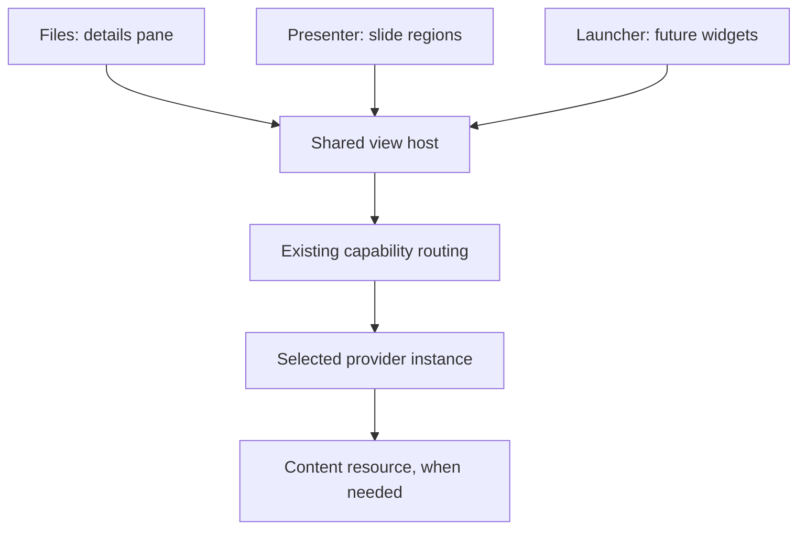

# Shared Embedded App Views for Solid Workbench

**Status:** Initial design proposal; not an implementation or finalized protocol  
**Date:** 12 November 2026  
**Scope:** Files details panes, Solid Presenter slide regions, future document embeds and Launcher widgets  
**Suggested repository location:** `design/solid-workbench-embedded-app-views-design.md`

**Weblets alignment review:** 12 November 2026. This is a staged Workbench
implementation of Weblets principles, not the complete Weblets protocol.

## 1. Purpose

Provide one shared mechanism through which a Solid application can host a view
supplied by another application. The host owns the surrounding layout and task;
the provider owns the embedded interface and the meaning of its content.

The first two consumers are:

- **Files:** a list-details interface, with files on one side and a selected
  resource displayed by a compatible provider on the other.
- **Solid Presenter:** slide templates containing regions that compatible viewer
  and editor applications can fill.

**Launcher widgets** are a third, later consumer. The existing roadmap describes
optional active pieces that start with Launcher and occupy a small area. These
should use the same hosting lifecycle rather than introduce another widget
runtime. Some widgets have a resource, such as an agenda; others may not, such
as a clock. Resource viewing is therefore one use of embedded app views, rather
than a requirement of every embedded instance.

Future document editors are another consumer: an embedded app view should follow
the containing document's typography and colours as far as the provider can
support. Styling hints are part of the initial shared contract, even though
document-editor integration remains future work.

**Terminology:** a named embedding area is a **region**, following the Weblets
collaboration design. The discussion's “slide slots” refer to these regions,
not a new SimplyFlow slot mechanism. Regions have stable identifiers independent
of DOM position and, when exposed for composition, names defined by the host's
layout capability contract.

## 2. Confirmed direction and scope

The maintainer's requirements from this discussion are:

1. Do not use SimplyEdit for the Presenter implementation.
2. Exclude remote presenting from the first MVP.
3. Let Presenter own slide layouts and regions; let other apps supply the content
   viewing and editing interfaces through capability checks.
4. Allow any Solid app implementing the required contract to fill a compatible
   region. Do not hardcode a privileged list of content applications.
5. Use the same mechanism for the future Files list-details view.
6. Make this reusable Workbench infrastructure, avoiding separate embedding
   designs for every host application.
7. Connect the design to future Launcher widgets without bringing widget
   implementation into the initial MVP.
8. Allow the containing app to supply styling hints, including fonts and colours,
   so embedded views can fit a document, slide or other surrounding composition.

Capability names, wire messages, vocabulary terms and package placement below
remain proposals. The user-facing task is viewing or editing content; HTML is
an implementation or content format, not the general capability name.

## 3. Architectural boundary

Distinguish three related responsibilities:

| Layer | Responsibility | Examples |
| --- | --- | --- |
| Semantic capability | Describe the useful operation a provider can perform | View a resource, edit a resource, display an agenda |
| Shared view host | Manage an embedded provider instance and its lifecycle | Open, ready, resize, focus, close, failure recovery |
| Consumer layout | Arrange views for a particular task | Files details pane, slide template, Launcher widget area |

A capability can also be invoked outside an embedded view, for example by
opening its standalone app. Embedding must not become the definition of viewing
or editing a resource.

Reuse the existing capability registry, provider selection and scoped transport.
The shared view host extends their presentation lifecycle; it does not create a
second broker, registry, renderer or authentication stack.

### Weblets independence and recursive hosting

The portable boundary must work without a particular Launcher, Solid server,
WebID, RDF runtime or JavaScript framework. Workbench supplies a Solid-aware
host implementation; it is not the definition of the embedding protocol. Its
RDF persistence rules apply to Workbench-owned composition resources, not to
every provider's internal state or every transient message.

Each participating app must remain useful at its own URL and define reasonable
fallbacks when host services are absent. A tab fallback for failed embedding is
helpful but does not by itself demonstrate standalone usefulness.

Any provider may also be a host. Its direct children request capabilities and
context through it. That host can satisfy, narrow, refuse or explicitly forward
a request upward; a grandchild must not bypass it to enumerate root or sibling
providers. Reusing Workbench routing may implement those decisions, but must
not turn the shared host library into one mandatory global runtime instance.

The first product flow can be shallow. Recursive host/child roles and scoped
connections are architectural invariants now; a general nested-layout editor
is later work. Prove the boundary with a small three-level composition before
claiming full Weblets compatibility.

Keep renderer responsibilities unchanged: the integration layer presents normal
iframe/loading/error/chrome components to SimplyFlow. It owns capability
discovery, connections and lifecycle; the renderer does not learn Weblets
semantics. Layout applications can expose interchangeable URI-identified APIs,
with narrower extension APIs where needed.

## 4. Ownership

| Concern | Host application | Provider application | Shared infrastructure |
| --- | --- | --- | --- |
| Layout | Allocates and labels a region or pane | Fits the allocated surface | Delivers size and visibility context |
| Appearance | Supplies styling hints from the local document or layout context | Maps supported hints to its own content styling | Delivers scoped hints and updates |
| Content | Supplies a resource/view reference or an explicit data capability | Interprets content using the agreed access mode | Transports scoped invocation data |
| Selection | Presents choices and respects user preferences | Advertises compatibility | Resolves candidates and connections |
| Editing | Requests an operation; owns persistence only in an explicitly host-owned draft contract | Owns editing UI and validation; saves or returns edits according to the contract | Supports lifecycle and status reporting |
| Persistence | Saves layout, references and any explicitly host-owned content | Saves directly owned content and recoverable drafts | Reuses existing storage APIs |
| Navigation | Owns the surrounding task and layout | Requests outward navigation where needed | Applies the agreed interaction contract |
| Closure | Requests transition or removal | Settles edits or explains why closure is blocked | Coordinates lifecycle and cleanup |

Hosts must not inspect provider DOM, translate its editor state or implement its
content schema. Providers must not assume ownership of the parent document,
global shortcuts, sibling regions or the host's account state.

## 5. Capability selection and compatibility

### Working names

`view-resource` and `edit-resource` are useful working names, not final public
identifiers. Avoid treating every provider as an HTML viewer/editor: contacts,
images, charts, notes and RDF entities can all supply an appropriate interface.
An HTML-resource viewer/editor may be one provider of those general operations.

A future widget can advertise a meaningful operation of its own using the same
embedding contract. Do not invent a universal `widget` capability merely to
label all small interfaces.

### Capability check

The host needs evidence that a candidate supports:

- The requested semantic operation.
- The resource's format or relevant RDF structure, when a resource is supplied.
- Embedded operation with the requested presentation and interaction behavior.
- The required lifecycle contract and compatible protocol version.

Use the existing Semantic Open With direction for media types, RDF recognition
and optional focus nodes. Keep document URI and RDF subject URI distinct. The
host must not acquire application-specific parsing rules merely to select a
provider. Full semantic discovery is not a prerequisite for the first proof:
explicit registrations and simple format matching are sufficient initially.

Declarations identify candidates. The selected provider confirms or declines
the actual request after inspecting its inputs. Loading a capability manifest
does not establish trust or grant access to the resource.

Explicit user choices and saved compatible provider selections take precedence
over recommendations. If no preferred provider exists, offer a choice. If a
saved provider is unavailable, show that fact and offer replacement; do not
silently disclose the resource to another application. Manual standalone
opening and download remain available in Files even when embedding is unsupported.

## 6. Common hosting contract

Use one small contract for persistent embedded instances. Exact field names and
messages must be reconciled with the existing broker before implementation.

### Invocation inputs

| Input | Meaning |
| --- | --- |
| Operation | URI identifying the semantic capability |
| Provider | Selected application identity and validated launch information |
| Resource or view | Resource/view URI and optional focus entity; resource operations require their defined target, while other operations may not |
| Data access | Explicit direct-resource or host-supplied capability mode; the first profile may implement direct-resource access only |
| Operation arguments | Typed arguments defined by the capability, rather than arbitrary executable configuration |
| Presentation | Allocated size, display policy, visibility and interaction requirements |
| Appearance hints | Declarative typography, colour and other supported styling values for this instance |
| Instance context | Host/region identity and current generation for lifecycle correlation |

The invocation shares only the context needed by the provider. Pass resource
references by default; do not forward whole decks, directory listings, credentials
or unrelated graphs. A resource URI alone does not confer read access.

### Source, view, provider and access mode

Preserve four independent concepts from the Weblets collaboration design:
source information, a selected/computed view, its rendering application, and
the synchronization mechanism. A selected table range or document paragraph
can be embedded by a stable view reference without embedding its original
editor or granting access to the entire source.

An optional focus entity is useful but does not describe every selection. Allow
capability-specific view references or descriptors; do not invent a universal
selection format or query language here. Give shared views stable identities
and keep copy, snapshot, live reference and fork distinguishable. The first
profile can use ordinary resource references and explicit refresh; it does not
promise live subscriptions or collaborative editing.

Direct resource access is the first proposed profile. The eventual contract
also permits host-supplied data, a narrow data capability, or a declared mixture.
In a host-owned draft session the provider returns edits through that contract
and must not independently save the same content. Direct-access providers own
their content writes. Declare which party owns persistence and conflicts for
each invocation; do not infer it from whether the UI is embedded.

These extension points do not grant general fetch authority or implement a new
data bus. Read, edit, subscribe and delegate remain separate permissions. The
bus connects applications and passes references/capabilities; it need not carry
every future collaborative operation. No collaboration engine is mandatory.

### Display and interaction requirements

Keep content format, interaction and geometry separate:

- **Resource operation:** viewing or editing.
- **Interaction:** passive display or user interaction.
- **Geometry:** a scrolling details area or a bounded presentation area with an
  explicit fit/overflow policy.

For example, Files can request an interactive scrolling view, while Presenter
requests a passive bounded view during presentation. A slide editor can open an
interactive editor for the same resource. A provider should decline unsupported
requirements instead of silently cropping content or substituting a full app UI.

The child may declare minimum, preferred and maximum dimensions, supported
layout modes and changes to its constraints. The host decides the actual
allocation and explicitly reports unmet constraints. Keep child constraints,
host allocation and observed content size distinct, with revisions to reject
stale updates and avoid resize loops.

The first profile can offer limited negotiation and fixed slide allocations;
do not freeze a one-way resize API that prevents richer negotiation later.
Complex layout algorithms remain deferred. The host's own interface stays
available for selection, replacement and errors.

### Styling hints from the containing app

An embedded view should be able to look like part of its containing document.
The host supplies a small, explicit appearance description with the initial
request and whenever that instance's styling context changes. This is distinct
from common Workbench UI preferences: a document may have a serif body font and
a particular palette while its surrounding editor uses the normal app theme.

The host resolves the applicable context at the insertion point, including
document, slide, section and region-specific overrides. It sends values that the
provider can interpret independently, rather than parent CSS selectors or
references to the host's private design-system variables.

Proposed initial hint groups are:

| Group | Examples | Intended use |
| --- | --- | --- |
| Typography | Preferred font families with fallbacks, base font size, line height, weight | Match surrounding text and spacing |
| Colours | Text/background pair, muted text, accent and accent-text pair, border | Match the containing surface with legible combinations |
| Surface | Light/dark colour scheme, optional transparent background over a known host background | Avoid an unrelated application panel inside a document |

Treat these as semantic hints, not a stylesheet language. Use bounded typed
values and a documented unit/colour representation. Do not pass arbitrary CSS,
selectors, style blocks, executable expressions or an unrestricted collection of
CSS properties. Add further tokens only when concrete providers need them.
The exact token names and encoding remain implementation decisions.

Providers translate supported hints into their own component variables. Muze
providers should expose provider-owned styling variables with a clear mapping
to these hints and defaults; they should not depend directly on the host's
the-ds variables. Independently implemented providers can make the same mapping
using their own toolkit. The shared protocol must not depend on a CSS library.

Hints apply to the embedded presentation of content. They do not rewrite the
resource or change the provider's global preferences. Ordinary inherited text
should follow the host where possible; intentional formatting and semantic
colours in content should remain meaningful. A chart's warning colour, source
code syntax or a document's explicitly authored emphasis is not simply an
accent to replace. A PDF page or photograph may offer little or no restyling.

User accessibility requirements take precedence over appearance matching.
Providers may adjust unsuitable colours or sizing and must retain usable focus
indicators and editor controls. Editing chrome can adopt compatible hints while
remaining visibly distinguishable from document content.

A provider reports which hint groups it supports and meaningful limitations,
such as fixed-layout content or a missing font. Partial support is a valid
outcome, not a false claim of exact visual equivalence. Report limitations to
the host without requiring an intrusive warning for every ignored hint.

Font names alone do not make custom fonts available in the provider. The first
contract uses fonts available to that provider and ordered fallback families;
it does not automatically fetch host-supplied font URLs. Sharing font resources,
loading policy and exact typography fidelity require a later explicit extension.

Appearance updates must preserve content, selection, drafts and undo history.
Send the complete current hint set with a revision within the instance's
generation; omission removes an earlier hint and restores the provider/content
default. This avoids stale styling after moving a view between contexts. Apply
updates without remounting the editor and ignore superseded revisions. If an
update causes overflow in a fixed slide region, report it through the existing
size/fit behavior instead of silently losing content.

Persist authored appearance choices with the host composition as native RDF.
Derive effective hints at runtime; do not snapshot all computed styles into
every region. If future compositions nest providers, an intermediate host can
derive hints for its children from its effective local context. Do not require
recursive composition in the MVP or bypass each child's scoped contract.

This matches the Weblets environmental-token direction. Support declarations
can describe isolated appearance, a small contextual theme or richer integration
without making those exploratory profile names permanent. Evaluate existing
web environment concepts and token serialization formats before finalizing the
wire format; this design does not establish a new token standard.

Styling must not hide application ownership. Passive document content may have
a quiet boundary with identity revealed on focus or inspection; editing and
privileged interfaces need stronger host-owned identification. Transparent
content backgrounds are permissible hints for ordinary regions, not permission
for transparent or unframed cross-boundary overlays.

### Lifecycle operations and signals

| Operation or signal | Required meaning |
| --- | --- |
| Open | Establish a scoped instance and ask it to load the operation |
| Ready | Requested content is usable, not merely that the iframe loaded |
| Failed / unsupported | Report an actionable failure without breaking siblings |
| Resize / visibility | Update the available surface and whether it is active |
| Layout constraints | Advertise minimum/preferred/maximum sizes and modes; host allocates and reports constraints it cannot meet |
| Appearance update / support | Apply revised hints without losing working state; report supported groups and meaningful limitations |
| Content changed | Identify the affected resource and distinguish local changes from remote persistence |
| Refresh | Request re-reading content without discarding an editor's pending work |
| Prepare transition | Settle or protect drafts before resource change, provider replacement, mode change or closure |
| Dispose | Release channels, observers, timers and instance resources after an allowed transition |

Resource changes can initially use an orderly close and open. A provider need
not support in-place retargeting. If retargeting is later added, it must uphold
the same draft-preservation rules. Do not require an indefinitely pending
request/reply call to represent an entire embedded lifetime; use the existing
transport's supported lifecycle mechanisms or a narrowly justified extension.

## 7. Transitions, cancellation and failure

The important shared behavior is preserving work when the host changes context.
Selecting another file and replacing a slide region use the same transition path.

1. Record the intended next resource/provider and generation.
2. Ask the active provider to prepare for transition. The provider owns any
   save, discard or cancel interaction and reports its actual outcome.
3. An active save or unresolved conflict may block the transition. Cancellation
   keeps the current view and its working state.
4. Once permitted, dispose the old instance and mount the selected replacement.
5. Ignore delayed ready/change/error messages from retired generations.

An allowed transition must remain valid until teardown: a provider must not
accept new edits between its final acknowledgement and disposal. Establish this
boundary during implementation rather than relying on a stale `canClose` flag.

Files may show a pending selection, but must not label old content as belonging
to the new file. Rapid A → B → C selection should cancel superseded opens and
never let B's late response replace C. Account or workspace changes invalidate
stale owner context and follow the same preservation rules.

Timeout or provider failure is not permission to discard drafts. Show retry and
standalone-opening options, and explain when the host cannot establish recovery
status. A crashed frame cannot promise to save after the fact; editing providers
need local draft recovery before claiming this lifecycle is reliable. A browser
crash bypasses graceful closure and must be considered separately from cancel.

## 8. Files: list-details resource browsing

Keep the file list as the list side. The details side hosts the selected resource
through the shared view mechanism. The Files app owns selection, provider
choice, available space and surrounding file operations.

The ordinary flow is select resource → resolve a compatible viewer → show
details. Show metadata or a useful fallback immediately when recognition or
loading is pending. Errors remain in the details pane and do not disable the
file list. On phones, the same relationship can use sequential list and details
screens instead of forcing two narrow columns.

Editing can be an explicit action opening a compatible editor in the same pane
or the established task presentation. Replacing a viewer with an editor uses the
common lifecycle. Completion refreshes the viewer; a failed save remains visible
and recoverable. Files does not become a text, image or contact editor itself.

## 9. Solid Presenter: layouts containing app views

Presenter owns decks, slide order, templates, region placement and presentation
navigation. Each region binds an independently supplied view to a content resource.

A template defines named regions, geometry and required behavior. It can constrain
a title region to a suitable text capability while allowing a main region to contain
an image, chart, document or another compatible view. It must not hardcode an
application identity where a capability contract is sufficient.

Each persisted region has a stable identifier, resource reference, selected
viewing provider, optional editing provider and relevant display options. The
viewing and editing providers may differ, provided both understand the content
representation. Provider identity and capability identity remain distinct.

### Authoring flow

1. Choose a template and select a region.
2. Choose an existing resource, or explicitly invoke a provider's supported
   content-creation operation. Do not assume `edit-resource` also means create.
3. Select a compatible viewing provider and show the resource in the region.
4. Activate Edit to invoke a compatible editor. Keep surrounding layout controls
   owned by Presenter.
5. After editing, refresh the view and preserve the region's identity and geometry.

The MVP must include one complete text-authoring path without SimplyEdit, as
well as selection of existing image content. An independently hosted editor
using the agreed contract is sufficient; Presenter need not contain its editor.

### Presentation flow

Presentation mode requests passive, bounded views, with provider navigation and
editing chrome absent. Provider controls must not capture the presenter's slide
navigation accidentally. If a provider cannot meet passive display requirements,
it is unsuitable for that region in presentation mode; a tab fallback is useful
for recovery but does not satisfy an in-slide view.

Present the currently selected slide locally. Remote audience synchronization,
cross-device control and remote session sharing are outside the first MVP.
Lifecycle support for hidden views is necessary because moving to another slide
may suspend or close its instances. Preserve pending edits before doing so.

Layouts reference live resources by default. This means subsequent content
changes may alter a presentation. Immutable publication/snapshots, revision
pinning, print/PDF export and self-contained distribution require later design;
embedding alone does not supply them.

### SimplyPresent as inspiration

[SimplyPresent](https://github.com/simplyedit/simplypresent) provides useful
precedent for six layouts—title, highlight, grid, half-grid, columns and full—and
for composing slide view, next-slide preview, notes and timer in a presenter UI.
Its edit templates also wrap display templates rather than duplicate layouts.

Reuse these layout ideas and suitable HTML/CSS through Workbench's current
component model. Replace content-specific fields with named regions where
appropriate. Do not carry over the SimplyEdit dependency, editor globals, old
Solid storage connector, or HyperHyperSpace remote-presenting integration.
Notes, timers and next-slide previews can be added after the basic region workflow;
their presence in SimplyPresent does not make them first-MVP requirements.

## 10. Launcher widgets: later reuse of the same mechanism

The existing roadmap places active widgets outside the MVP and leaves their
embedding model open. This proposal identifies shared app-view hosting as their
intended foundation; it does not authorize implementation or startup execution
of arbitrary third-party code.

| Consumer | Content selection | Persistence | Typical presentation |
| --- | --- | --- | --- |
| Files details | Changes with file selection | Usually transient; preferences may persist | Interactive, scrollable |
| Presenter region | Bound to a slide | Deck stores layout and binding | Passive and bounded while presenting |
| Launcher widget | Chosen by the user; resource optional | Workspace stores placement and provider binding | Compact, often interactive |

A widget is a configured provider instance with a small surface, not a new
component format. Its configuration names an operation, provider, optional
resource and operation-specific arguments. For example, a calendar provider
could show an agenda for a chosen calendar; a clock provider may need no content
resource at all.

When widget work begins, reuse open/ready/visibility/transition/dispose and
failure isolation. Activation follows the user-selected workspace and saved
widget configuration. Hidden or inactive widgets should suspend unnecessary
work; background activity, startup requests, network cost and any write actions
need explicit policy. Starting Launcher must not silently broaden access or
turn saved widget configuration into unrestricted automation.

Do not require a widget-only routing system. Conversely, do not make Files and
Presenter depend on widget placement, scheduling or a dashboard editor.

## 11. Embedding, authority and interoperability

The proposed default for independently hosted app views is provider-owned UI
in an iframe connected through the existing origin/window-bound scoped channel.
Do not inject provider scripts or arbitrary returned HTML into the host.
Third-party apps need to implement the view contract, but need not use SimplyFlow
or any Muze framework internally.

Same-origin SimplyFlow components remain useful for trusted local composition.
They are not a substitute for isolation between independent applications. Keep
their dependencies explicit and their editable definitions reconstructible under
the moldability rules; do not create a separate widget or AI component model.

Capability advertisements, a read-only UI mode and iframe boundaries do not
themselves grant or revoke Solid permissions. Providers use their authorized
data access; the host does not send bearer credentials. A provider's view-only
contract must be distinguished from server-enforced read-only authority.

Verify actual frame policies, authentication behavior and lifecycle across
origins. A provider that cannot be framed remains available through normal
standalone opening. Keep errors actionable without automatically downgrading
origin or authorization checks.

No iframe DOM access is needed to host a view. Define focus entry/exit and outward
navigation explicitly. Prefer passive providers that implement the requested
behavior; enforce host focus rules where possible without claiming that UI
suppression is a security boundary.

### Weblets authority and overlay invariants

API identity, application URL and a private authorized provider connection are
three different things. A connection is scoped to a consumer instance, provider
instance, API, composition and lifetime. Knowing an API URI or appearing in a
catalogue does not supply that connection. Allow user review and revocation;
delegation is explicit and cannot increase authority beyond the direct host's
grant. Do not treat a shared registry as ambient access to running instances.

Use explicit browser containment policies appropriate to each provider and
verify their actual enforcement. Independently untrusted code must not share
the host origin; same-origin in-repository apps require a distinct trust model.
Do not describe ordinary iframe sandboxing as network confinement. A networked
provider may disclose data it has received; stronger brokered data profiles
remain separate research and must not be claimed without evidence.

Navigation or document replacement ends the old embedded security session:
invalidate its ports and grants and require a new handshake with origin/window
verification. Lifecycle disconnection is distinct from disposal of still-live
drafts. A failed connection does not authorize discarding content.

For interactions that need space outside a region, prefer semantic host services
such as file/person selection. Do not let a provider escape its allocated area
through parent DOM access. Arbitrary cross-boundary overlay hosting can remain
deferred. If introduced, it requires an opaque host-owned frame, verified origin
indication, close control, constrained placement and focus return. Styling hints
must never hide that ownership or let child content cover the host's controls.

## 12. Persistence, offline behavior and accessibility

Persist layouts and bindings as native RDF/Turtle using existing Workbench
infrastructure. Decks and workspaces store identifiers, content references and
typed configuration, not live frame handles, session secrets, HTML snapshots or
JSON blobs inside Turtle. Preserve unknown statements and unrelated subjects.

Under direct-resource access, content and drafts remain provider-owned.
Removing a region, widget or
view reference does not delete its content resource. Provider replacement does
not implicitly convert content or grant a different app access. Host undo covers
layout/binding changes; provider undo covers content edits. Do not claim one
atomic undo transaction across independently saved resources.

Where the operation explicitly uses a host-owned draft, that host owns durable
content persistence instead; the provider still owns its editing interaction.
This exception is selected by the data-access contract, not guessed by the host.

Save composition relationships and reconnection intent: parent/child identities,
regions, selected providers, API connections and state-resource references where
needed. The initial profile stores only relationships it actually uses. Never
persist live ports or transferable grants. Restoration verifies current origins,
API support and valid authority; importing a composition or restoring an old
selection must not silently grant new or expanded permissions.

Offline usefulness requires both available provider code and available content.
A cached deck alone is insufficient. Show placeholders for unavailable views;
preserve bindings and layouts through failure. An editor reports local saving
and remote synchronization separately. External live updates and cross-provider
conflict handling remain provider concerns, with host refresh notices as needed.

Use labelled frames/surfaces, visible focus and keyboard navigation between host
controls and providers. Hosts must support selecting and replacing regions without
dragging. Providers must declare and demonstrate a usable embedded core task;
iframe embedding alone does not establish accessibility. Test mobile Files
navigation and slide editing at practical sizes.

Load only needed providers and measure total cold-load cost, including nested
apps, images, frames and authentication. Reuse existing Workbench download goals;
do not count only the host bundle. Start with few regions and explicit visibility
lifecycle before considering instance pooling or more complex optimization.

## 13. Existing foundation and required work

The reviewed Workbench revision already has managed apps, capability routing,
provider-owned iframe/dialog presentation, tab fallback and close checks. These
are foundations, not proof of a generic long-lived multi-region protocol.

The alignment review checked repository revision
`5a326434b1ad457de97ede9be1b771ed65ede14e`. Its accepted CYC151 follow-up
supersedes the earlier CYC145 baseline: the roadmap and evidence record envelope
validation, cooperative disconnect, observed iframe-navigation recovery and
removal of the obsolete live route. There is deliberately no universal payload
byte cap; operation owners retain domain validation.

The recorded limits still include arbitrary process-loss detection and some
noncooperating separate-tab failures. These are documented implementation
evidence, not tests rerun for this design review. Do not reintroduce obsolete
routes or describe repaired cases as unresolved prerequisites. Persistent and
nested view hosting still needs its own evidence beyond the task-presenter tests.

Inspect and reuse actual APIs before adding host abstractions. Identify exactly
which lifecycle behavior the existing task presenter lacks for a long-lived pane
or multiple slide regions. Keep the new shared layer limited to those gaps and
preserve the existing governed broker direction.

## 14. Delivery plan and acceptance

### Phase 1: shared contract and Files proof

Define the smallest interoperable view contract and implement a Files details
pane using a resource viewer. Demonstrate provider selection, usable readiness,
resource changes, initial styling hints, live appearance updates, failure and
disposal. Use a second independently hosted
compatible provider to prove replacement without host-specific changes.

### Phase 2: Presenter proof using the same host

Adapt a small subset of SimplyPresent-inspired layouts into named regions. Use
text and image providers, and deliver text creation/editing without SimplyEdit.
Demonstrate multiple simultaneous regions and a local presentation flow.

### Phase 3: resilience and usability

Verify recovery of edits, reload, cancellation, stale events, account/workspace
transitions, offline content, cross-origin failure, phone use and keyboard/focus
behavior. Measure complete download and runtime cost before expanding layouts.

### Later: widgets and broader composition

Apply the same contract to a resource-backed widget and a widget without a
resource. Set startup, visibility and background policies. Further semantic
recognition, saved compositions, AI-assisted composition and export can build on
this foundation without being prerequisites for the initial consumers.

### Acceptance scenarios

1. The same provider displays the same resource in Files and a Presenter region
   without host-specific provider code.
2. The same host lifecycle implementation serves both consumers; application
   code supplies layout and context rather than duplicate orchestration.
3. A second provider can replace the first without changing either host's source.
4. Incompatible capabilities, content or presentation requirements are explained;
   manual standalone opening remains possible where appropriate.
5. Selecting another file or replacing a region preserves drafts on cancellation
   and distinguishes local persistence from successful remote synchronization.
6. Rapid selection changes, provider reload and delayed messages cannot display
   stale content under a new resource label or leave calls hanging indefinitely.
7. One failed region does not prevent other regions or the host from working.
8. Reload restores layout and bindings without relying on live frame identities;
   absent providers produce recoverable placeholders.
9. Keyboard and mobile reviews cover host-to-provider focus, editing, navigation
   and replacement; automated evidence is reported separately.
10. No SimplyEdit dependency or remote-presenting service is required for the MVP.
11. The contract permits a non-resource operation for future widgets without
    making resource operations accept missing resource arguments.
12. The same text provider follows different host font and colour hints in Files
    and Presenter without provider-specific host code or changes to its content.
13. Changing appearance during editing preserves the draft, selection and undo
    history. Removing hints restores defaults; delayed updates cannot reinstate
    obsolete styling.
14. Missing fonts, fixed-layout content and partial hint support have documented
    fallbacks. Accessibility settings and meaningful content colours survive.
15. Styling one embedded instance does not alter sibling instances, the provider's
    standalone appearance, or common Workbench preferences.

### Additional gates before claiming full Weblets compatibility

- Open participating apps directly and demonstrate meaningful standalone use;
  also embed one in an independent host without a Launcher, WebID or RDF runtime.
- Exercise host → child host → grandchild: requests pass through the direct
  parent, sibling capabilities are unavailable, and delegation cannot broaden
  authority. No general layout editor is required for this proof.
- Exchange minimum/preferred/maximum size constraints, allocate a constrained
  region and report an unsatisfied minimum without a resize loop.
- Save and restore a composition's region identities and connection intent,
  including a revoked provider and an origin/API change requiring review.
- Check visible ownership, navigation invalidation and stale-message rejection.
  Test framed overlays separately if that optional feature is implemented.
- Before claiming live transclusion, demonstrate one addressable partial view
  with a replaceable renderer and no implicit access to the complete source.

These gates distinguish the Workbench MVP from the eventual Weblets contract;
they do not add remote presenting or a collaboration engine to the MVP.

Record implementation scope, evidence and acceptance in a dedicated Spiral cycle.
This document does not select a cycle, supersede existing accepted broker work,
or claim that the proposed interfaces are already implemented.

## 15. Decisions to resolve during implementation

- Final semantic capability names, URIs and versioned input/result contracts.
- How the current task-presenter lifecycle is extended for persistent surfaces.
- Minimum display requirements and provider compatibility declarations.
- Initial appearance tokens, typed values, update acknowledgements and font
  fallback behavior; demonstrate them in the first shared-host proof.
- Concrete independent text/image providers and text-creation behavior.
- RDF representation for deck templates, region bindings and provider preferences.
- Draft recovery guarantees and exact transition acknowledgement semantics.
- Cross-origin authentication/framing constraints and resource limits grounded
  in actual providers and measurements.

Keep the public contract small. Complex layout algorithms, a general nested
composition editor, widget startup policies and immutable publication remain
later work. Preserve basic size negotiation, recursive authority and protocol
independence now, rather than treating those principles as future redesigns.

## 16. Weblets alignment findings

**Verdict:** the application-based direction is consistent with Weblets. The
initial draft was incomplete about several defining boundaries. This revision
makes those boundaries explicit while preserving the restricted product MVP.
This is architectural alignment, not certification of an implemented protocol.

| Weblets requirement | Finding and resolution | Primary design source |
| --- | --- | --- |
| Complete standalone applications; no mandatory Solid shell | Clarified protocol independence and useful standalone behavior; Workbench is one host implementation | Weblets core §§2–4, 15 |
| API URI differs from implementation and authority | Existing distinction retained; private connection identity and revocation made explicit | Weblets core §6; security §§9–10 |
| Recursive hosting with immediate-parent authority | Earlier deferral was too broad; invariant now explicit, nested-layout editor still deferred | Weblets core §4; security §§4, 14 |
| Named regions; renderer unaware of Weblet semantics | Corrected technical “slot” terminology and separated integration from SimplyFlow rendering | Collaboration §8 |
| Child requests space; host allocates | Replaced one-way sizing language with constraints/allocation semantics and staged negotiation | Weblets core §7 |
| Styling hints with visible ownership | Already aligned; clarified experimental tokens, partial support and protected overlay chrome | Weblets core §8; security §§15–16 |
| Source, selected view, renderer and synchronization remain separate | Added partial-view and host-supplied-data extension points; no mandatory collaboration runtime | Original weblets-1; collaboration §§4, 14–15 |
| Restartable compositions with valid scoped authority | Added relationship/state-reference preservation and reauthorization checks on restoration | Weblets core §§4, 12; security §19 |
| Existing Workbench capability/composition direction | Reuses routing and provider selection without introducing a parallel framework; updates the CYC151 baseline | Broker roadmap; AI composition §§2–5 |

Sources have different authority and scope: `weblets-1.md` through
`weblets-3.md` are original project notes; the three July design documents are
exploratory syntheses that mark principles versus provisional mechanisms. The
November Workbench designs describe staged product work. Later maintainer
instructions here exclude SimplyEdit and remote presenting from this MVP;
historical references to SimplyEdit, Braid, CRDTs or particular bus libraries
are not dependency requirements. No transport or browser-support claim was
independently certified by this document comparison.

## References and evidence basis

The design reflects the maintainer discussion of 12 November 2026. Source
observations refer to the revisions below, not a claim of current browser or
deployment verification. Recheck relevant implementation and standards before
coding the public contract.

- [Original Weblets model: weblets-1.md](https://chatgpt.com/library?file_id=libfile_01da105308048191a276c5b51d58136d&account_id=personal): standalone applications, URI APIs, host-supplied data, embedding and styling.
- [Original security notes: weblets-2.md](https://chatgpt.com/library?file_id=libfile_7d3b8b960c8c8191a1283b7042884a34&account_id=personal): historical questions, not current browser-support evidence.
- [Original motivation: weblets-3.md](https://chatgpt.com/library?file_id=libfile_917f6a55941c81918e5dec4e033dea71&account_id=personal): user composition, independence and introspection.
- [Weblets core design](https://chatgpt.com/library?file_id=libfile_32152e35e6948191ab0633870cdbf912&account_id=personal): hosting, API identity, layout, visual context and persistence.
- [Weblets collaboration design](https://chatgpt.com/library?file_id=libfile_a540968486d481919dd1bfe1169b9421&account_id=personal): regions, source/view/renderer separation and optional collaboration.
- [Weblets security design](https://chatgpt.com/library?file_id=libfile_5a4b7ba64ee081918b610dcd23bc4af3&account_id=personal): parent-mediated authority, visible seams, overlays, revocation and restoration.

- [SimplyPresent](https://github.com/simplyedit/simplypresent/tree/a01a3af855ba1a3d9ebc4846eb0bea84fd9f8cf8): layout and presenter-workflow inspiration.
- [SimplyPresent presenter composition](https://github.com/simplyedit/simplypresent/blob/a01a3af855ba1a3d9ebc4846eb0bea84fd9f8cf8/src/pages/present/pageTemplates/present.html).
- [SimplyPresent slide templates](https://github.com/simplyedit/simplypresent/blob/a01a3af855ba1a3d9ebc4846eb0bea84fd9f8cf8/src/components/slides/componentTemplates/slides.html).
- [Workbench roadmap](https://github.com/muze-labs/solid-workbench/blob/5a326434b1ad457de97ede9be1b771ed65ede14e/design/solid-apps-roadmap.md): active Launcher widgets remain outside the MVP.
- [Capability broker roadmap](https://github.com/muze-labs/solid-workbench/blob/5a326434b1ad457de97ede9be1b771ed65ede14e/design/solid-capability-broker-roadmap.md): existing lifecycle, routing and recorded recovery limits.
- [Semantic Open With](https://github.com/muze-labs/solid-workbench/blob/5a326434b1ad457de97ede9be1b771ed65ede14e/design/solid-semantic-open-with-design.md): resource recognition and provider selection.
- [Moldable Solid Apps](https://github.com/muze-labs/solid-workbench/blob/5a326434b1ad457de97ede9be1b771ed65ede14e/design/Moldable-Solid-Apps.md): explicit editable definitions and dependencies.
- [AI-Composable Solid Workbench](https://github.com/muze-labs/solid-workbench/blob/5a326434b1ad457de97ede9be1b771ed65ede14e/design/solid-workbench-ai-composition-design.md): broader composition direction; no separate AI/widget component model.
- [Semantic clipboard](https://github.com/muze-labs/solid-workbench/blob/5a326434b1ad457de97ede9be1b771ed65ede14e/design/solid-semantic-clipboard-design.md): reference exchange and application-owned meaning remain independent of embedded presentation.
- [CYC151 reliability evidence](https://github.com/muze-labs/solid-workbench/blob/5a326434b1ad457de97ede9be1b771ed65ede14e/.spiral/evidence/EVD-20261112-QG24H-155.md) and [acceptance](https://github.com/muze-labs/solid-workbench/blob/5a326434b1ad457de97ede9be1b771ed65ede14e/.spiral/acceptance/ACC-20261112-QG24H-156.md): repaired cases and remaining implementation limits.
